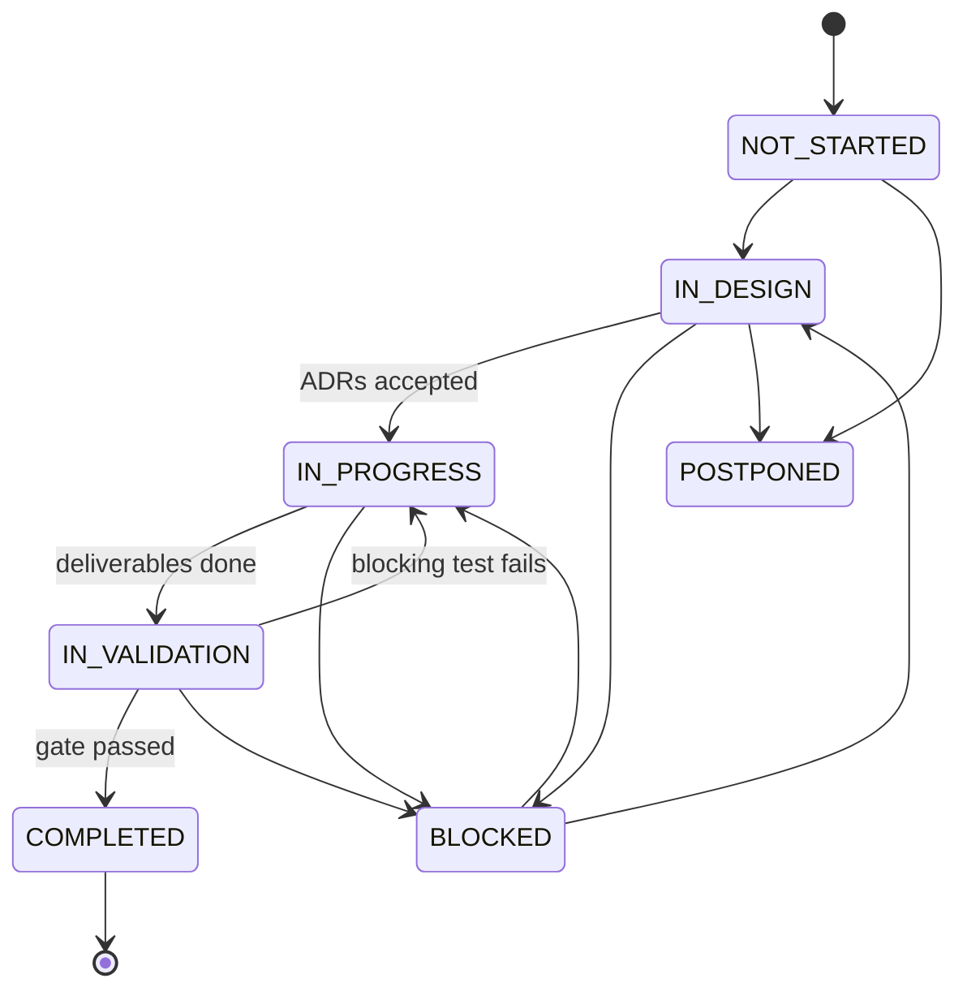
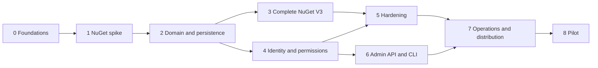

# MVP Roadmap — Private NuGet package registry

> Phase plan derived from [mvp-private-nuget-registry.md](mvp-private-nuget-registry.md).
> Architecture decisions are in [adr-mvp.md](adr-mvp.md).
>
> Last updated: 2026-11-16

---

## Decisive MVP test

> A team installs the server, configures its project, publishes a library and restores it from CI; then revokes a credential and recovers the service from a backup, **without opening a web interface or manually editing the database**.

All phases exist so that this sentence is verifiable end to end in Phase 8.

---

## Status system

### Phase status

| Status | Meaning | Entry condition |
|---|---|---|
| ⚪ `NOT STARTED` | Planned, no active work. | Initial state. |
| 🔵 `IN DESIGN` | Fine scope, ADRs and test cases are defined. Product code is not written yet. | Dependencies in `IN VALIDATION` or `COMPLETED`. |
| 🟡 `IN PROGRESS` | Active implementation of deliverables. | Phase ADRs in `Accepted` status and acceptance criteria written. |
| 🟣 `IN VALIDATION` | Deliverables implemented; blocking tests and the gate review are run. | All deliverables marked done. |
| 🟢 `COMPLETED` | Exit gate passed and evidence recorded. | All blocking tests green and evidence linked. |
| 🔴 `BLOCKED` | Cannot advance. It must state **reason**, **unblock condition** and **owner**. | Any active state. |
| ⚫ `POSTPONED` | Deliberately removed from the MVP. Requires an ADR or decision note. | Explicit scope decision. |

**Rules:**

1. A phase only moves to `COMPLETED` with linked evidence (PR, test report, execution log). "It works on my machine" is not evidence.
2. If a blocking test fails in `IN VALIDATION`, the phase returns to `IN PROGRESS`; it does not advance with informal exceptions.
3. A later phase may start `IN DESIGN` while its dependency is `IN VALIDATION`, but not `IN PROGRESS`.
4. `BLOCKED` always carries a block with: *reason*, *since* (date), *unblock condition*, *owner*.
5. A change that reopens a `COMPLETED` phase is recorded as a regression in the current phase, not by reopening the previous one.

### Deliverable status

Each deliverable within a phase uses a checkbox with a marker:

| Marker | Meaning |
|---|---|
| `[ ]` | Pending |
| `[~]` | In progress |
| `[x]` | Done (with evidence) |
| `[!]` | Blocked (add note) |
| `[-]` | Discarded / moved outside the phase (add note) |

---

## Overview

| # | Phase | Status | Depends on | Exit gate (summary) |
|---|---|---|---|---|
| 0 | Project foundations | 🟢 `COMPLETED` | — | Workspace builds in CI and base ADRs accepted. |
| 1 | NuGet compatibility spike | 🟢 `COMPLETED` | 0 | Real `dotnet` publishes and restores against the server; Rust/C# decision ratified. |
| 2 | Domain core and persistence | 🟢 `COMPLETED` | 1 | Consistent, immutable publication resistant to crashes. |
| 3 | Complete NuGet V3 surface | 🟢 `COMPLETED` | 2 | Matrix of tested clients green. |
| 4 | Identity, authentication and authorization | 🟢 `COMPLETED` | 2 | Feeds isolated on all endpoints; revocable tokens. |
| 5 | Hardening against packages and abuse | 🟢 `COMPLETED` | 3, 4 | Malicious ZIP/XML rejected; version blocking operational. |
| 6 | Administrative API and `onepack` CLI | 🟢 `COMPLETED` | 4 | Complete registry operation from the terminal. |
| 7 | Operations, recovery and distribution | 🟢 `COMPLETED` | 5, 6 | Backup restored on another server; binaries published. |
| 8 | Pilot and MVP closeout | 🟡 `IN PROGRESS` | 7 | Decisive test executed by a real team. |

Phases 3 and 4 can advance in parallel. Phase 6 can advance in parallel with 5.

---

## Phase 0 — Project foundations

**Status:** 🟢 `COMPLETED` — evidence: [CI run 37174401011](https://github.com/Khr0x/onepack/actions/runs/37174401011).
**Depends on:** —
**ADRs:** [ADR-001](adr-mvp.md#adr-001), [ADR-003](adr-mvp.md#adr-003), [ADR-019](adr-mvp.md#adr-019)

### Objective
Leave a repository where any change builds, is tested and is reviewed reproducibly, and where the base decisions are recorded.

### Deliverables
- [x] Cargo workspace with empty crates: `core`, `nuget`, `storage`, `api-client`, `server`, `cli` (`onepack-*` packages). ADR-003 boundaries verified by `scripts/check-crate-deps.sh`.
- [x] Folder structure: `migrations/`, `tests/{integration,conformance-dotnet,security,recovery}`, `packaging/{systemd,container}`, `docs/`.
- [x] CI (`.github/workflows/ci.yml`, `ubuntu-24.04` runners): `cargo fmt --check`, `clippy -D warnings`, `cargo test`, crate boundaries, `cargo deny` (licenses, advisories, sources). [Green on GitHub](https://github.com/Khr0x/onepack/actions/runs/37174401011).
- [x] Pinned toolchain (`rust-toolchain.toml`, 1.96.1); MSRV = `rust-version` 1.96, documented in `docs/conventions.md`.
- [x] CI job with .NET 8 SDK that packages the fixtures in `tests/conformance-dotnet/fixtures` (without being a server dependency). [Green on GitHub](https://github.com/Khr0x/onepack/actions/runs/37174401011).
- [x] Conventions in `docs/conventions.md`: error format, code prefixes, provisional CLI exit codes, commits and branches.
- [x] Confirmed binary names: `onepackd` (server) and `onepack` (CLI).
- [x] ADR-001, ADR-003 and ADR-019 `Accepted` (2026-10-03); ADR-002 remains `Conditional` until the Phase 1 gate.

### Out of scope
Any functional endpoint.

### Exit gate
- A sample PR passes the entire CI pipeline on Linux x86-64.
- Base ADRs `Accepted`.

---

## Phase 1 — NuGet compatibility spike

**Status:** 🟢 `COMPLETED` — evidence: [CI run 37176042099](https://github.com/Khr0x/onepack/actions/runs/37176042099), [spike report](../docs/spikes/phase-1-nuget-compatibility.md).
**Depends on:** Phase 0
**ADRs:** [ADR-002](adr-mvp.md#adr-002), [ADR-008](adr-mvp.md#adr-008), [ADR-009](adr-mvp.md#adr-009), [ADR-019](adr-mvp.md#adr-019)

### Objective
Reduce the greatest technical risk **before** investing in administration, permissions or CLI: demonstrate that a minimal Rust server is accepted by real NuGet clients. This phase is the decision point to ratify or revert Rust versus C#.

### Deliverables
- [x] Minimal Axum server with a fixed feed (`--feed`), no authentication, provisional storage on disk (`crates/server`).
- [x] `index.json` (service index) with only the implemented resources; URLs built from `--public-url` (ADR-018).
- [x] `PackagePublish/2.0.0`: multipart `PUT`; `X-NuGet-ApiKey` is accepted without validation. Accepts `/v2/package` and `/v2/package/` (the client appends the trailing slash).
- [x] `PackageBaseAddress/3.0.0`: version list in NuGet order, `.nupkg` download (original bytes) and `.nuspec`.
- [x] `.nuspec` reading from the ZIP: id, version and dependencies per framework (`crates/nuget/src/package.rs`).
- [x] NuGet id and version normalization (`crates/nuget/src/{id,version}.rs`).
- [x] Conformance suite: corpus of 168 cases generated with `NuGet.Versioning` 7.9.0 and verified in CI (`scripts/version-corpus.sh --check`, `crates/nuget/tests/version_corpus.rs`).
- [x] E2E test `scripts/e2e-dotnet.sh`: `dotnet pack` → `dotnet nuget push` → `dotnet restore` with an isolated cache → `dotnet run`.
- [x] Spike report: [docs/spikes/phase-1-nuget-compatibility.md](../docs/spikes/phase-1-nuget-compatibility.md).

### Blocking tests
| Scenario | Expected result |
|---|---|
| Push and restore with the current `dotnet` SDK | Success with an empty cache. |
| Versions `1.0`, `1.0.0`, `1.0.0.0` | Treated as the same identity. |
| Prerelease and build metadata | Normalization identical to `NuGet.Versioning`. |
| Package with dependencies per framework | Restore resolves the transitive dependency. |

### Exit gate
- E2E green in CI.
- Normalization divergences = 0 over the case corpus.
- ADR-002 moves from `Conditional` to `Accepted` (Rust) **or** is replaced by an ADR in favor of C#. If the stack changes, this roadmap is rewritten from Phase 2.

---

## Phase 2 — Domain core and persistence

**Status:** 🟢 `COMPLETED` — evidence: [CI run 37180525028](https://github.com/Khr0x/onepack/actions/runs/37180525028).
**Depends on:** Phase 1
**ADRs:** [ADR-004](adr-mvp.md#adr-004), [ADR-005](adr-mvp.md#adr-005), [ADR-006](adr-mvp.md#adr-006), [ADR-007](adr-mvp.md#adr-007), [ADR-020](adr-mvp.md#adr-020)

### Objective
Turn the spike into a durable core: several feeds, immutable versions, consistent publication even if the process crashes.

### Deliverables
- [x] SQLite schema with embedded SQLx migrations (`migrations/0001_initial.sql`, `STRICT` tables): `feed`, `package`, `package_version`, `blob`, `audit_event`.
- [x] `UNIQUE(feed_id, normalized_package_id, normalized_version)` in the database.
- [x] SQLite in WAL, `synchronous=FULL`, `busy_timeout` of 5 s, `foreign_keys`; single-connection write pool and separate read pool.
- [x] `BlobStore` on filesystem (`crates/storage/src/blobs.rs`): `blobs/sha256/ab/cd/<hash>` and `staging/`, with deduplication.
- [x] Publication flow: streaming to staging with incremental hash → inspection from the file → `fsync` of the file → atomic rename → `fsync` of directories → metadata + audit transaction.
- [x] No SQLite transaction open during the upload; the upload is not loaded into memory.
- [x] Identity conflict → `409`; the domain indicates whether the content is identical (`PublishError::Conflict { identical }`) for `--skip-existing-identical`.
- [x] Staging and orphan blob cleanup with a grace period (`--gc-grace-secs`), on startup and periodically.
- [x] Startup verification: database initialized, pending migrations or newer schema, write access to the data directory, low free space warning.
- [x] Forward-only migrations with `onepackd migrate` and a prior `VACUUM INTO` copy if data already existed (ADR-020).
- [x] Crate separation respected: `core` without external dependencies; `storage` without `nuget` or `axum`.
- [x] Local feed management with `onepackd feed create|list` (remote management arrives with the API in Phase 6).

### Blocking tests
| Scenario | Expected result | Test |
|---|---|---|
| Two simultaneous publications of the same identity | Only one confirmed; the other receives `409`; no overwrite. | `storage/tests/store.rs` (8 tasks), `server/tests/nuget_api.rs` (6 over HTTP) |
| Process kill during the upload | No partially available version appears. | `server/tests/recovery.rs` (SIGKILL mid-upload) |
| Kill between persisting the blob and committing the DB | Orphan blob detected and cleaned after the grace period. | `server/tests/recovery.rs` (injected `abort`, `fault-injection` feature) |
| Disk full during the upload | Controlled error; no metadata points to a nonexistent blob. | `tests/recovery/disk-full.sh` (8 MiB tmpfs, Linux/CI only) |
| Restart after publishing | Downloaded bytes identical (hash) to the published ones. | `server/tests/recovery.rs` |
| Same package in two feeds | Two independent identities; blob can be deduplicated. | `storage/tests/store.rs`, `server/tests/nuget_api.rs` |

### Exit gate
All blocking tests automated (crate tests and `tests/recovery`) and green in CI.

---

## Phase 3 — Complete NuGet V3 surface

**Status:** 🟢 `COMPLETED` — evidence: [CI run 37185158143](https://github.com/Khr0x/onepack/actions/runs/37185158143). Manual IDE cells are deferred to the pilot (Phase 8).
**Depends on:** Phase 2
**ADRs:** [ADR-009](adr-mvp.md#adr-009), [ADR-013](adr-mvp.md#adr-013), [ADR-019](adr-mvp.md#adr-019)

### Objective
Implement all announced resources with their real requirements and publish a matrix of tested clients.

### Deliverables
- [x] `RegistrationsBaseUrl/3.6.0`: index, pages (64 versions; inline up to 128) and leaves; dependency groups per framework with each dependency's `registration`; ranges; `listed` (`crates/nuget/src/v3.rs`).
- [x] `SearchQueryService`: `q` (terms, `id:`, `packageid:`), `skip`, `take`, `prerelease`, `semVerLevel`, `packageType`; stable order by relevance and id.
- [x] `SearchAutocompleteService`: ids (`q`) and versions of an id (`id`).
- [x] `DELETE` (unlist) and `POST` (relist) in `PackagePublish`, with publish permission on the id and auditing.
- [x] Unlisted versions: out of search and autocomplete, present in the flat container and registrations (`listed: false`) and downloadable.
- [x] SemVer 2.0.0 filtered according to `semVerLevel` (by default, SemVer 1.0.0 only).
- [x] Absolute URLs only from `public_url`; test with tampered `Host` and `X-Forwarded-*` and E2E behind nginx with TLS.
- [x] `.nuspec` metadata (title, authors, tags, license, icon, readme, package types…) saved on publish (migration 0003) and backfilled on startup for earlier versions.
- [x] Package corpus created with `dotnet pack`: multi-target with dependencies (`Dependent`), dependency range (`Ranged`), SemVer 2.0.0 prerelease with extensive metadata, icon and readme (`Rich`), and three versions of `Basic`.
- [x] Client matrix in [docs/compatibility.md](../docs/compatibility.md): all automatic cells green; IDE (manual) cells deferred to the pilot.

### Target client matrix (minimum)
| Client | Platform | Operations | Test |
|---|---|---|---|
| `dotnet` CLI (SDK 10 LTS and previous 8 LTS) | Linux, macOS, Windows | push, restore, search, list | `scripts/e2e-dotnet.sh` (Linux SDK 8 and 10, macOS SDK 10), `e2e-windows.ps1` (SDK 8) |
| `nuget.exe` | Windows | push, restore, search | `tests/conformance-dotnet/e2e-windows.ps1` |
| Visual Studio / Rider | Windows / macOS | browsing and restore (manual, documented) | manual |
| CI (GitHub Actions / Azure Pipelines) | Linux | restore and push with injected credentials | GitHub Actions jobs; Azure Pipelines without environment |

### Blocking tests
| Scenario | Expected result | Test |
|---|---|---|
| Unlisted version | Does not appear in search; remains restorable by exact version. | `server/tests/catalog.rs`, E2E (`dotnet nuget delete`) |
| Paginated search with prerelease and SemVer2 | Results consistent with the protocol. | `server/tests/catalog.rs`, E2E (`dotnet package search`, `nuget.exe search`) |
| Transitive dependency with range | `dotnet restore` resolves the correct version. | E2E: `Ranged` → `Basic` 1.1.0 among 1.0.0, 1.1.0 and 2.0.0; `nuget.exe install` |
| Behind a reverse proxy with TLS | Correct service index URLs. | E2E with nginx + TLS (`ONEPACK_E2E_TLS=1`) and test with tampered headers |

### Exit gate
Client matrix with all automatable cells green in CI and manual ones documented with date and version.

---

## Phase 4 — Identity, authentication and authorization

**Status:** 🟢 `COMPLETED` — evidence: [CI run 37182166437](https://github.com/Khr0x/onepack/actions/runs/37182166437).
**Depends on:** Phase 2 (parallelizable with Phase 3)
**ADRs:** [ADR-010](adr-mvp.md#adr-010), [ADR-011](adr-mvp.md#adr-011), [ADR-012](adr-mvp.md#adr-012)

### Objective
Mandatory authentication and per-feed permissions applied on **all** endpoints, including metadata, `HEAD` and conditional responses.

### Deliverables
- [x] `principal` (user / service), `token`, `feed_grant` and `grant_publish_pattern` entities (`migrations/0002_identity.sql`).
- [x] Opaque tokens `opk_<id>_<secret>` (256 bits), stored as a SHA-256 verifier and shown only once (`crates/storage/src/tokens.rs`).
- [x] Mandatory expiration (90 days by default), immediate revocation and `last_used_at` written at most every 5 minutes per token.
- [x] Roles per feed: Reader ⊂ Publisher ⊂ Maintainer; global Administrator (`crates/core/src/auth.rs`).
- [x] Publication restriction by id pattern (`Hemia.Payments.*`), checked when the package id is known.
- [x] Authentication mechanisms per surface (see the clarification in ADR-011):
  - [x] Admin API: only `Authorization: Bearer`.
  - [x] NuGet: Basic with the token as password, or `X-NuGet-ApiKey`; `401` with `WWW-Authenticate: Basic`.
  - [x] NuGet publish: `X-NuGet-ApiKey` (or Basic, which the client sends after the `401`).
- [x] Single global authentication middleware (`crates/server/src/auth.rs`), which also covers nonexistent routes; handlers only obtain a feed through `authorized_feed`, which authorizes at the same time.
- [x] `onepackd init`: migrates, creates the administrator and writes the initial credential to `initial-admin-token` (`0600`, `0700` directory); no default password.
- [x] Identical `404` response for nonexistent feeds and feeds without read permission.
- [x] Auditing of authentication failures, principals, tokens, grants, publications and denials, with the actor.
- [x] Secrets out of logs: HTTP traces do not record headers and rejections only record the token id.
- [x] Local management: `onepackd principal create`, `token create|revoke`, `grant set|remove` (the remote API arrives in Phase 6).
- [x] `GET /api/v1/whoami`: identity and permissions of the credential.

### Blocking tests
| Scenario | Expected result | Test |
|---|---|---|
| Revoked token | The next request receives `401`. | `server/tests/auth.rs`, E2E with `dotnet` |
| Expired token | `401`; it is not renewed implicitly. | `server/tests/auth.rs`, `storage/tests/identity.rs` |
| Cross-feed read without permission | No leak via search, autocomplete, registrations, flat container, `.nuspec` or `HEAD`. | `server/tests/auth.rs` (all existing routes; search and registrations will be covered when added in Phase 3) |
| Publisher outside its prefix | `403` with code `AUTH_PREFIX_DENIED`. | `server/tests/auth.rs` |
| Reader tries to publish or unlist | `403`. | `server/tests/auth.rs` (publish and unlist) |
| Logs after a complete flow | They do not contain any token. | `server/tests/recovery.rs` (`RUST_LOG=trace`), E2E with `dotnet` |
| `dotnet restore` with credentials via `NuGetPackageSourceCredentials_*` | Success. | `scripts/e2e-dotnet.sh` |

### Exit gate
Route coverage test: 100% of registered routes require authentication except the explicit public route list (empty; `anonymous_read` is not implemented).

---

## Phase 5 — Hardening against packages and abuse

**Status:** 🟢 `COMPLETED`
**Depends on:** Phases 3 and 4
**ADRs:** [ADR-013](adr-mvp.md#adr-013), [ADR-014](adr-mvp.md#adr-014), [ADR-018](adr-mvp.md#adr-018)

### Objective
Treat every `.nupkg` as untrusted content and protect the service against saturation.

### Deliverables
- [x] Configurable limits: compressed size, number of ZIP entries, uncompressed size per entry and total, `.nuspec` size, XML depth, inspection time.
- [x] XML parser without DTD or external entities.
- [x] Rejection of dangerous paths (`..`, absolute, reserved names) without extracting to disk.
- [x] Inspection with limited concurrency (semaphore) separate from the pool serving downloads.
- [x] Rate limiting per principal and IP; concurrent upload limit (`max_concurrent_uploads`).
- [x] Quotas per feed (total storage, number of versions).
- [x] `availability: available | blocked` state independent of `listed`; blocked downloads return an explicit error.
- [x] Auditing of block/unblock with reason.
- [x] Documentation: the registry does not analyze malware or validate signature trust; a block does not delete copies already downloaded.

Evidence: [`tests/security`](../tests/security/main.rs) suite, blocking step with `dotnet restore` in `scripts/e2e-dotnet.sh`, and [docs/security.md](../docs/security.md) (limits, error codes and manual review).

### Blocking tests
| Scenario | Expected result |
|---|---|
| ZIP bomb | Controlled rejection within the memory/time budget. |
| XML bomb (billion laughs) | Controlled rejection. |
| Entry with path traversal | Rejection; nothing written outside staging. |
| Upload burst | Controlled degradation (`429`/`503`), without unlimited task growth. |
| Blocked version | `restore` fails with a clear message; it remains visible to administrators. |
| Quota exceeded | `403`/`413` with a specific code; nothing persisted. |

### Exit gate
`tests/security` suite green in CI and documented manual security review.

---

## Phase 6 — Administrative API and `onepack` CLI

**Status:** 🟢 `COMPLETED`
**Depends on:** Phase 4 (parallelizable with Phase 5)
**ADRs:** [ADR-015](adr-mvp.md#adr-015), [ADR-016](adr-mvp.md#adr-016)

### Objective
Make the registry fully operable from the terminal, both by people and by pipelines.

### Deliverables — `/api/v1` API
- [x] Feeds, principals, tokens, grants, packages (list, inspect, unlist/relist, block/unblock), auditing endpoints.
- [x] Capabilities and version endpoint for negotiation with the CLI.
- [x] Errors with a stable code, message, suggested action and `request_id`.
- [x] Cursor pagination.
- [x] Contract defined in `api-client` and shared by server and CLI.

### Deliverables — CLI
- [x] `onepack context add|list|use|remove`.
- [x] `onepack login|logout` with no-echo input or `--token-stdin`; OS keychain storage; explicit error if there is no keychain (no silent plain-text fallback).
- [x] `onepack feed create|list|show|configure`.
- [x] `onepack principal create|list|disable`, `onepack token create|list|revoke`, `onepack grant add|remove|list`.
- [x] `onepack package list|inspect|push|unlist|relist|block|unblock`, with `--skip-existing-identical`.
- [x] `onepack audit list`.
- [x] `onepack nuget init --dry-run`: generates/updates `NuGet.Config` with `packageSourceMapping`, preserves what exists, shows the diff, writes no secrets.
- [x] `onepack exec --feed X -- <command>`: injects `NuGetPackageSourceCredentials_*` only into the child process environment.
- [x] `onepack doctor`: DNS, TLS, authentication, permissions, service index, `NuGet.Config`, source mapping.
- [x] Cross-cutting: stable `--json`, documented exit codes, `--no-input`, timeouts, data to stdout and diagnostics to stderr, confirmation on destructive operations, shell autocompletion.
- [x] Retries only on idempotent operations.

Evidence: API in [docs/api.md](../docs/api.md) (contracts in `crates/api-client`), CLI in [docs/cli.md](../docs/cli.md), tests `crates/server/tests/admin_api.rs` and `crates/cli/tests/cli.rs` (includes `--json` schema snapshot and N-1 server), and `scripts/e2e-cli.sh` with real `dotnet`. Guide: [docs/guide-zero-to-ci.md](../docs/guide-zero-to-ci.md).

### Blocking tests
| Scenario | Expected result |
|---|---|
| Complete flow without UI: feed → CI principal → token → grant → push → restore | Success using only `onepack` and `dotnet`. |
| `onepack exec -- dotnet restore` | Restores; the token does not appear in files or in the parent shell environment. |
| `nuget init` over an existing `NuGet.Config` | Preserves previous sources; diff shown before applying. |
| `doctor` with a token without publish permission | Reports `AUTH_SCOPE_MISSING` with the required action, without showing the secret. |
| CLI version N against N-1 server | Works or fails with a missing-capability message. |
| `--json` output | Validated against the schema snapshot. |

### Exit gate
"From zero to restore in CI" guide in `docs/` executed literally by someone who did not write the code.

> Closeout (2026-10-04): the guide was executed literally locally and its flow is automated in `scripts/e2e-cli.sh` (green in CI). Execution by someone who did not write the code is deferred to the Phase 8 pilot by user decision.
---

## Phase 7 — Operations, recovery and distribution

**Status:** 🟢 `COMPLETED`
**Depends on:** Phases 5 and 6
**ADRs:** [ADR-017](adr-mvp.md#adr-017), [ADR-018](adr-mvp.md#adr-018), [ADR-020](adr-mvp.md#adr-020)

### Objective
Make the service installable, upgradable, observable and recoverable predictably.

### Deliverables — Recovery
- [x] Maintenance mode: pauses mutations and blob cleanup.
- [x] `onepackd backup`: consistent database copy (`VACUUM INTO`, see clarification in ADR-017) + verified referenced blobs + manifest with hashes. Service configuration does not live in the data directory: it is documented to store it separately.
- [x] `onepackd restore` over an empty directory, with manifest verification.
- [x] `onepackd check`: DB ↔ blobs integrity (missing, orphaned, incorrect hashes).
- [x] Migrations: schema version, prior check (`migrate --check`), automatic backup before migrating, forward-only.

### Deliverables — Observability
- [x] Structured JSON logs with `request_id`.
- [x] Metrics endpoint (requests, latencies, uploads, rejections, disk space).
- [x] `/healthz` (live) and `/readyz` (DB and storage accessible).

### Deliverables — Distribution
- [-] Server binaries: Linux x86-64 and ARM64 (static, musl). `release.yml` workflow ready; first run deferred to Phase 8.
- [-] CLI binaries: Linux, macOS (x86-64/ARM64), Windows. Same workflow; first run deferred to Phase 8.
- [x] systemd unit with hardening (`ProtectSystem`, `NoNewPrivileges`, dedicated user).
- [x] Optional container image (non-root, data volume).
- [x] Reverse proxy examples (Nginx/Caddy) that do **not** serve blobs directly.
- [-] Checksums and signature of release artifacts (SHA-256 + keyless cosign, verified in the workflow itself). First run deferred to Phase 8.

### Deliverables — Performance
- [x] Reproducible benchmark on 2 vCPU / 1 GB / SSD (`scripts/bench.py --docker`, CI *Benchmark* job).
- [x] Goal measurement: startup < 2 s, idle RSS < 100 MiB, metadata p95 < 50 ms, bounded memory in transfers.
- [x] Report with real results (goals not met are documented, not hidden).

Evidence: `crates/storage/tests/ops.rs`, `crates/server/tests/operations.rs`, `scripts/e2e-recovery.sh` (backup on Linux → restore on macOS in CI), `tests/ops/` (systemd, container, proxies), [docs/performance.md](../docs/performance.md) and [docs/runbooks/](../docs/runbooks/).

### Blocking tests
| Scenario | Expected result |
|---|---|
| Backup → restore on another server → `dotnet restore` | The project restores its dependencies. |
| Blob manually deleted | `onepackd check` detects and reports it. |
| Upgrade N-1 → N with migration | Data intact; prior backup generated. |
| Restart by systemd after a crash | Service returns to `ready` without intervention. |

### Exit gate
Recovery test executed on infrastructure different from the original and documented in `docs/runbooks/`.

> Closeout (2026-10-04): gate passed in CI, with backup on Linux and restore + `dotnet restore` on macOS (another machine and another operating system). By user decision, the first run of `release.yml` and the transcription of the container benchmark results (2 vCPU / 1 GiB) to `docs/performance.md` are deferred to Phase 8; those results are in the CI *Benchmark* job summary.
---

## Phase 8 — Pilot and MVP closeout

**Status:** 🟡 `IN PROGRESS` — branch `feature/phase-8-pilot`. Pilot material in [docs/pilot](../docs/pilot/README.md).
**Depends on:** Phase 7

### Objective
Validate with a real team that the product solves the problem and execute the decisive test.

### Deliverables
- [x] Automated end-to-end decisive test ([`scripts/e2e-acceptance.sh`](../scripts/e2e-acceptance.sh)): install, configure, publish, restore from CI, revoke and rotate the credential, block a version and recover from backup, without UI or database access. In CI (SDK 8 and 10, Linux and macOS) and in `release.yml` against the release binaries.
- [x] Pilot material: [plan](../docs/pilot/README.md), [friction log](../docs/pilot/friction-log.md), [incident exercise](../docs/runbooks/incident-drill.md) and [release procedure](../docs/runbooks/release.md).
- [x] Project license: [Apache License 2.0](../LICENSE), declared in the crates (`license = "Apache-2.0"`), included in release files and in the container image.
- [ ] Pilot team identified (e.g., a Hemia team) with at least one library and one CI pipeline.
- [ ] Installation done by the pilot team following only the documentation.
- [ ] Use in usual builds and publications during an agreed period (e.g. 2–4 weeks).
- [ ] Incident exercise: revoke CI credential, block a version, restore from backup.
- [ ] Manual verification with Visual Studio and Rider (deferred from Phase 3), noted in `docs/compatibility.md`.
- [ ] Literal execution of the [from zero to restore in CI](../docs/guide-zero-to-ci.md) guide by someone who did not write the code (deferred from Phase 6).
- [x] First run of `release.yml` (binaries, checksums and signature): [dry run 37891824376](https://github.com/Khr0x/onepack/actions/runs/37891824376). Candidate `88467a9` validated in [dry run 39068572157](https://github.com/Khr0x/onepack/actions/runs/39068572157), with signature verified outside Actions and acceptance of the downloaded binaries on Linux ARM64. Promotion remains blocked by F-002: updated `cargo deny check` fails (OP-036 / OP-045).
- [x] Revalidation of 2026-10-29: candidate `f84978b`, [dry run 40900732673](https://github.com/Khr0x/onepack/actions/runs/40900732673) with 9 correct jobs, 7 checksums and signature verified outside Actions, acceptance and CLI of the downloaded binaries approved on clean Linux ARM64. F-002 is fixed in the new artifact; promotion remains blocked by four new cargo-deny warnings, F-003/OP-046 (TLS) and F-004/OP-047 (Tokio). Evidence in Obsidian: `OP-036-Resultados-2026-10-29`; see [current frictions](../docs/pilot/friction-log.md#current-candidate-validation--2026-10-29). No release is published and the pilot is not closed.
- [x] Container benchmark results (2 vCPU / 1 GiB) from the *Benchmark* job noted in [docs/performance.md](../docs/performance.md): [CI run 38917726054](https://github.com/Khr0x/onepack/actions/runs/38917726054), commit `88467a9`, run of 2026-10-16; goals, figures and limitations documented (OP-002).
- [x] Dependency update of 2026-11-16: local commits `bc78dc4` (`rustls-webpki` 0.103.17, `webpki-roots`/`webpki-root-certs` 1.0.12, Tokio 1.54.1) and `1a50859` (`sqlx 0.9.1` temporary pin and `libsqlite3-sys` 0.39.1) resolve F-003/F-004/F-005. `cargo deny` passes; also fmt, Clippy, 151 tests, boundaries, Linux E2E of TLS/keychain, acceptance and disk-full. Remove the pin and `allow-git` when publishing sqlx 0.9.1. The new candidate with CI and a signed artifact is still missing; no push or release. See [current frictions](../docs/pilot/friction-log.md#dependency-gate-update--2026-11-16).
- [ ] OP-051 (F-006): verify the `url` 2.5.9 dependency update with cargo-deny and the CI matrix before accepting the next candidate. See [RUSTSEC-2026-0592](https://rustsec.org/advisories/RUSTSEC-2026-0592).
- [ ] Friction, error and request log; classification into "MVP blocking" / "post-MVP".
- [ ] Fix all MVP blockers.
- [ ] Retrospective and update of the evolution order (credential provider, S3, proxy…).

### MVP close criteria
- [ ] The decisive test runs completely without UI or manual DB editing.
- [ ] Zero open data loss or corruption incidents.
- [ ] Zero known cross-feed leaks.
- [ ] Client matrix and operations documentation updated.
- [ ] `v0.1.0` release tagged with signed binaries.

---

## Outside the MVP (reference)

Recorded to prevent it from entering through the back door. Any inclusion requires a new ADR.

| Feature | Planned stage |
|---|---|
| NuGet credential provider, package import, S3 storage | First evolution |
| nuget.org proxy/cache with provenance rules | Second evolution |
| npm | Third evolution |
| Symbols, PyPI, SSO, web interface | As demanded |
| PostgreSQL, multinode, high availability | Only with demonstrated need |

---

## Status change log

| Date | Phase | From | To | Note / evidence |
|---|---|---|---|---|
| 2026-10-03 | 0 | `NOT STARTED` | `IN DESIGN` | Initial roadmap and ADRs drafted. |
| 2026-10-03 | 0 | `IN DESIGN` | `IN PROGRESS` | ADR-001, 003 and 019 accepted; `onepackd`/`onepack` binaries. |
| 2026-10-03 | 0 | `IN PROGRESS` | `IN VALIDATION` | Deliverables implemented; checks green locally. Pending: CI on GitHub. |
| 2026-10-04 | 0 | `IN VALIDATION` | `COMPLETED` | Gate passed: [CI run 37174401011](https://github.com/Khr0x/onepack/actions/runs/37174401011). Runner pinned to `ubuntu-24.04` (with `ubuntu-latest` the jobs did not receive a runner). |
| 2026-10-04 | 1 | `NOT STARTED` | `IN DESIGN` | Dependency (Phase 0) completed. |
| 2026-10-04 | 1 | `IN DESIGN` | `IN PROGRESS` | ADR-008 and ADR-009 accepted. |
| 2026-10-04 | 1 | `IN PROGRESS` | `IN VALIDATION` | Corpus without divergences and E2E green locally. Pending: CI on GitHub. |
| 2026-10-04 | 1 | `IN VALIDATION` | `COMPLETED` | Gate passed: [CI run 37176042099](https://github.com/Khr0x/onepack/actions/runs/37176042099) (corpus + E2E with dotnet). ADR-002 accepted (Rust). PR Khr0x/onepack#2. |
| 2026-10-04 | 2 | `NOT STARTED` | `IN DESIGN` | Dependency (Phase 1) completed. |
| 2026-10-04 | 2 | `IN DESIGN` | `IN PROGRESS` | ADR-004, 005, 006, 007 and 020 accepted. |
| 2026-10-04 | 2 | `IN PROGRESS` | `IN VALIDATION` | 37 tests and E2E with dotnet green locally. Pending: CI (includes disk-full on Linux). |
| 2026-10-04 | 2 | `IN VALIDATION` | `COMPLETED` | Gate passed: [CI run 37180525028](https://github.com/Khr0x/onepack/actions/runs/37180525028), with recovery tests (`fault-injection`) and disk-full on tmpfs. |
| 2026-10-04 | 3 | `NOT STARTED` | `IN DESIGN` | Dependency (Phase 2) completed. |
| 2026-10-04 | 4 | `NOT STARTED` | `IN DESIGN` | Dependency (Phase 2) completed; parallelizable with Phase 3. |
| 2026-10-04 | 4 | `IN DESIGN` | `IN PROGRESS` | ADR-010, 011 and 012 accepted. |
| 2026-10-04 | 4 | `IN PROGRESS` | `IN VALIDATION` | 66 tests and authenticated E2E with dotnet green locally. Pending: CI. |
| 2026-10-04 | 4 | `IN VALIDATION` | `COMPLETED` | Gate passed: [CI run 37182166437](https://github.com/Khr0x/onepack/actions/runs/37182166437), with route coverage, feed isolation and authenticated E2E. |
| 2026-10-04 | 6 | `NOT STARTED` | `IN DESIGN` | Dependency (Phase 4) completed; parallelizable with Phase 5. |
| 2026-10-04 | 3 | `IN DESIGN` | `IN PROGRESS` | ADR-013 accepted. |
| 2026-10-04 | 3 | `IN PROGRESS` | `IN VALIDATION` | Tests and E2E with SDK 8 green locally. Pending: matrix in CI (SDK 8/10, macOS, Windows, TLS) and manual IDEs. |
| 2026-10-04 | 3 | `IN VALIDATION` | `COMPLETED` | Automatic matrix green: [CI run 37185158143](https://github.com/Khr0x/onepack/actions/runs/37185158143). Closed by user decision with the manual IDE cells (Visual Studio, Rider) deferred to the Phase 8 pilot. |
| 2026-10-04 | 5 | `NOT STARTED` | `IN DESIGN` | Dependencies (Phases 3 and 4) completed. |
| 2026-10-04 | 5 | `IN DESIGN` | `IN PROGRESS` | ADR-014 and ADR-018 accepted. Branch `feature/phase-5-hardening` (from this phase on, git flow branches in English). |
| 2026-10-04 | 5 | `IN PROGRESS` | `IN VALIDATION` | `tests/security` suite (16 tests) and E2E with blocking green locally; manual review in `docs/security.md`. Pending: CI. |
| 2026-10-04 | 5 | `IN VALIDATION` | `COMPLETED` | Gate passed: [CI run 37232454014](https://github.com/Khr0x/onepack/actions/runs/37232454014), with the "Security suite" step and the blocking E2E across the whole matrix (SDK 8/10, Linux with TLS, macOS, Windows). Manual security review in `docs/security.md`. PR Khr0x/onepack#6. |
| 2026-10-04 | 6 | `IN DESIGN` | `IN PROGRESS` | ADR-015 and ADR-016 accepted. Branch `feature/phase-6-admin-api-cli`. |
| 2026-10-04 | 6 | `IN PROGRESS` | `IN VALIDATION` | `/api/v1` API and CLI complete; 142 tests, `e2e-cli.sh` and the guide executed locally (SDK 8). Pending: CI and literal execution of the guide by someone who did not write the code. |
| 2026-10-04 | 6 | `IN VALIDATION` | `COMPLETED` | CI green: [CI run 37236552774](https://github.com/Khr0x/onepack/actions/runs/37236552774), with `e2e-cli.sh` on Linux (SDK 8 and 10) and macOS (SDK 8 and 10). Closed by user decision with third-party execution of the guide deferred to the Phase 8 pilot. PR Khr0x/onepack#7. |
| 2026-10-04 | 7 | `NOT STARTED` | `IN DESIGN` | Dependencies (Phases 5 and 6) completed. |
| 2026-10-04 | 7 | `IN DESIGN` | `IN PROGRESS` | ADR-017 accepted. Release signing: SHA-256 + keyless cosign. Branch `feature/phase-7-operations`. |
| 2026-10-04 | 7 | `IN PROGRESS` | `COMPLETED` | CI green: [CI run 37247176082](https://github.com/Khr0x/onepack/actions/runs/37247176082), 11 jobs: Linux → macOS recovery with `dotnet restore`, systemd with restart after SIGKILL, container, proxies and benchmark. Closed by user decision; the first run of `release.yml` and the container benchmark numbers are deferred to Phase 8. PR Khr0x/onepack#8. |
| 2026-10-04 | 8 | `NOT STARTED` | `IN DESIGN` | Dependency (Phase 7) completed. |
| 2026-10-04 | 8 | `IN DESIGN` | `IN PROGRESS` | No new ADRs. Branch `feature/phase-8-pilot`: automated decisive test and pilot material. First friction (F-001, blocking) fixed: `onepack exec` checks the credential before launching `dotnet`. Apache-2.0 license by user decision. |
